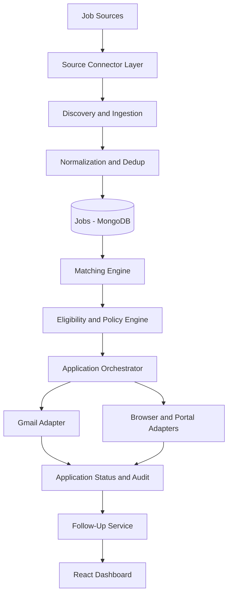
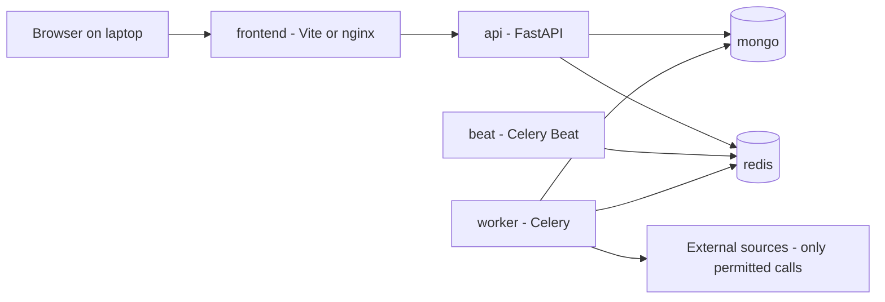

# High-Level Design

## 1. Architecture style

A **modular monolith**: one Python codebase with clear internal module boundaries, deployed as three processes (API, worker, scheduler) sharing MongoDB and Redis. Microservices are deferred until there is a demonstrated need.

## 2. Pipeline

## 3. Runtime topology

| Process | Responsibility | Talks to external platforms? |
|---|---|---|
| `api` | REST API, validation, enqueue background work | No |
| `worker` | Discovery, normalization, matching, orchestration, Gmail | Yes, via connectors only |
| `beat` | Schedules hourly discovery and maintenance | No |
| `mongo` | Durable state (source of truth) | - |
| `redis` | Broker, locks, rate-limit counters, cache | - |
| `frontend` | Dashboard | No |

The API and dashboard bind to `127.0.0.1` only. MongoDB and Redis are not published on the host. Nothing is exposed to the internet.

## 4. Architectural rules

1. Business logic is independent of any source-specific implementation.
2. Route handlers never call external platforms; they enqueue tasks.
3. Long-running work runs in Celery tasks.
4. Durable state lives in MongoDB. Redis is coordination only and is never the sole record of an application.
5. Important tasks are idempotent.
6. Connectors are replaceable plug-ins registered in a connector registry.
7. Discovery permissions are separate from application permissions.
8. Dry-run and global pause are enforced centrally in the `ApplicationOrchestrator`, not in the UI.
9. AI or heuristic output never bypasses policy checks; it is input to them.

## 5. Key decisions

| Decision | Choice | Reason |
|---|---|---|
| Mongo driver | PyMongo native async (`AsyncMongoClient`) | Motor was removed in Phase 1. One driver only. |
| Settings storage | `automation_settings` singleton document in Mongo | The starter keeps settings in a process-global variable, which is lost on restart and not shared between api and worker. |
| API versioning | `/api/v1/*` | Starter `/api/*` routes stay as deprecated aliases until the frontend migrates (Phase 6). |
| Matching | Deterministic, explainable factor scoring first | Reproducible and testable; any later AI scoring only feeds factors and never decides eligibility. |
| Locks | Redis `SET NX PX` with token-checked release | Simple, sufficient for one host. |
| Task results | Recorded in Mongo `task_runs` | Celery result backend is transient. |
| Frontend state | TanStack Query | Caching, retries, loading and error states for server data. |
| Delivery | GitHub Actions CI, images published to GHCR, pulled locally | No cloud host; the laptop is the deployment target. |

## 6. Delivery pipeline

```mermaid
flowchart LR
  Pr[Pull request] --> Scan[Secret scan]
  Scan --> Unit[Unit tests and lint]
  Unit --> Integration[Integration tests - Mongo and Redis]
  Integration --> Build[Docker image build]
  Build --> Smoke[Compose stack smoke test]
  Smoke --> E2E[Playwright e2e - from Phase 6]
  E2E --> Merge[Merge to main]
  Merge --> Publish[Publish images to GHCR]
  Publish --> Deploy["scripts/deploy.ps1 on laptop"]
```

## 7. Deployment on Windows

Prerequisites: Windows 10/11, Docker Desktop (WSL 2 backend, Linux containers), Git. See [README.md](../README.md) for PowerShell commands.

## 8. Out of scope for the first release

Telegram and WhatsApp sources, multi-user accounts, cloud hosting, microservices.
