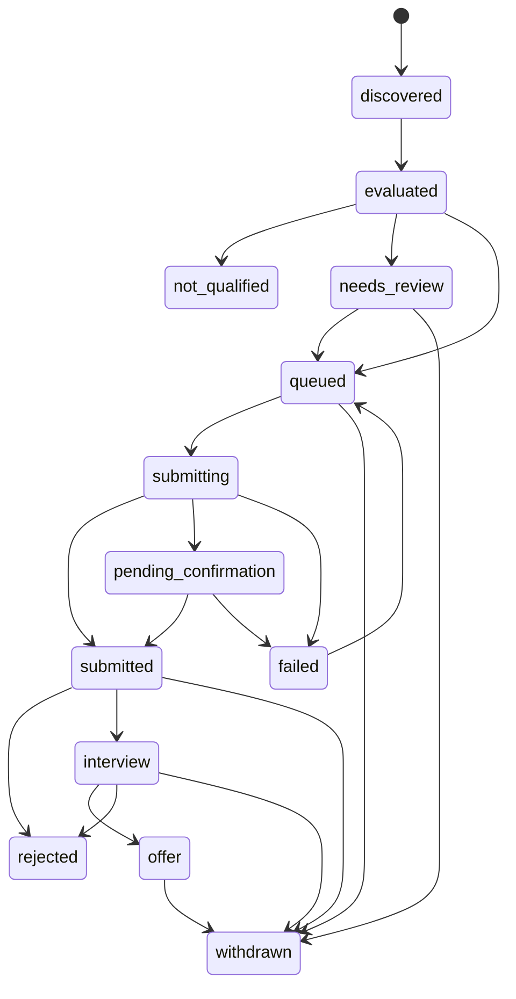
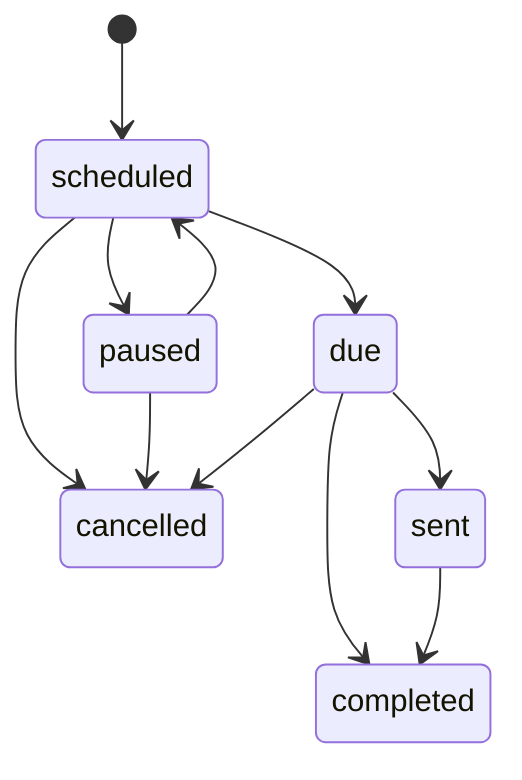

# Low-Level Design

## 1. Target backend layout

```
backend/app/
  main.py                    # FastAPI app factory, lifespan, middleware, router mount
  core/
    config.py                # pydantic-settings, validated at startup
    logging.py               # structured JSON logging, correlation IDs, secret redaction
    errors.py                # AppError hierarchy -> error envelope
    security.py              # auth dependency, URL safety (SSRF guard)
    locks.py                 # Redis distributed lock
    rate_limit.py            # Redis per-source rate limiter
  db/
    client.py                # AsyncMongoClient lifecycle
    indexes.py               # all index definitions
  models/                    # Pydantic domain models (one file per aggregate)
    job.py  match.py  application.py  profile.py  message.py
    followup.py  source.py  audit.py  settings.py  task_run.py  common.py
  repositories/              # ONLY place that touches MongoDB
    jobs.py  matches.py  applications.py  profiles.py  messages.py
    followups.py  sources.py  audit.py  settings.py  task_runs.py
  services/                  # business logic, no HTTP, no driver calls
    discovery.py  normalization.py  deduplication.py  matching.py
    eligibility.py  orchestrator.py  resume.py  email.py
    recruiter_reply.py  followup.py  audit.py  integration_health.py
  connectors/
    base.py                  # JobSourceConnector, ApplicationChannel, Capability
    registry.py              # source_name -> connector instance
    linkedin/  naukri/  wellfound/  career_pages/  gmail/
    mock/                    # deterministic connectors for tests
  api/v1/
    router.py
    routes/  profile.py jobs.py applications.py sources.py automation.py
             followups.py audit.py health.py
    schemas/                 # request/response models, pagination, errors
  tasks/
    celery_app.py  schedule.py
    discovery.py  matching.py  applications.py  gmail.py  followups.py  maintenance.py
backend/tests/
  unit/  integration/  smoke/  fixtures/
```

Layering rule: `routes -> services -> repositories / connectors`. Routes never import repositories or connectors directly. Services receive dependencies through constructors so they can be tested with fakes.

## 2. Connector interfaces (`connectors/base.py`)

```python
class Capability(StrEnum):
    DISCOVER = "discover"
    FETCH_DETAILS = "fetch_details"
    INGEST_EMAIL = "ingest_email"
    SUBMIT_APPLICATION = "submit_application"
    SEND_EMAIL = "send_email"

class CapabilityStatus(StrEnum):
    SUPPORTED = "supported"        # implemented, configured, verified
    UNCONFIGURED = "unconfigured"  # implemented but credentials/config missing
    UNVERIFIED = "unverified"      # access/permission not yet verified against provider docs
    UNSUPPORTED = "unsupported"    # provider does not permit it / not implemented

class ConfigurationResult(BaseModel):
    status: Literal["configured", "unconfigured", "invalid"]
    missing: list[str] = []        # names of missing settings, never values
    message: str

class HealthResult(BaseModel):
    healthy: bool
    checked_at: datetime
    error_code: str | None = None

class RawJob(BaseModel):           # connector output before normalization
    source: str
    source_job_id: str | None
    url: str | None
    payload: dict[str, Any]        # untrusted content

class JobSourceConnector(ABC):
    source_name: ClassVar[str]
    capabilities: ClassVar[dict[Capability, CapabilityStatus]]
    restrictions: ClassVar[list[str]]          # human-readable policy notes
    required_settings: ClassVar[list[str]]

    async def validate_configuration(self) -> ConfigurationResult: ...
    async def discover_jobs(self, since: datetime | None) -> list[RawJob]: ...
    async def fetch_job_details(self, source_job_id: str) -> RawJob | None: ...
    def normalize_job(self, raw: RawJob) -> JobCreate: ...
    async def health_check(self) -> HealthResult: ...

class ApplicationChannel(ABC):                 # optional, separate interface
    channel_name: ClassVar[ApplicationChannelType]

    async def validate_application(self, app: Application) -> ValidationResult: ...
    async def submit_application(self, app: Application) -> SubmissionResult: ...
    async def check_submission_status(self, app: Application) -> SubmissionResult: ...
```

Rules:
- Calling a method whose capability is not `SUPPORTED` raises `CapabilityUnavailableError(source, capability, status)`. It never returns an empty "success".
- `SubmissionResult.outcome` is one of `confirmed`, `ambiguous`, `rejected_by_channel`, `transient_error`, `permanent_error`. Only `confirmed` with evidence can lead to `submitted`.
- Connectors never read application policy; the orchestrator decides whether to call them.

### Initial capability matrix (all UNVERIFIED until documented in IMPLEMENTATION_PLAN)

| Source | discover | fetch_details | ingest_email | submit_application | send_email |
|---|---|---|---|---|---|
| linkedin | unverified | unverified | unsupported | unsupported | unsupported |
| naukri | unverified | unverified | unsupported | unsupported | unsupported |
| wellfound | unverified | unverified | unsupported | unsupported | unsupported |
| career_pages | unverified | unverified | unsupported | unverified | unsupported |
| gmail | unsupported | unsupported | unconfigured | unsupported | unsupported |

### Registry

`ConnectorRegistry` maps `source_name -> JobSourceConnector` and `channel_name -> ApplicationChannel`. It exposes `list_sources()`, `get(source)`, `channels_for(source)`. Unknown sources raise `UnknownSourceError` (404 at the API).

## 3. Domain services

| Service | Responsibility | Depends on |
|---|---|---|
| `JobDiscoveryService` | Run a connector discovery, record a discovery run, hand raw jobs to normalization | registry, rate limiter, lock, task_runs repo |
| `JobNormalizationService` | `RawJob -> JobCreate`; canonicalize URL; compute `content_hash`; unknown -> `None` | connector `normalize_job`, URL utils |
| `JobDeduplicationService` | Find existing job by ordered signals; upsert or flag | jobs repo |
| `JobMatchingService` | Compute factor scores, total, exclusions, explanation | profile repo, matches repo |
| `ApplicationEligibilityService` | Evaluate hard exclusions and threshold | matches, applications repos |
| `ApplicationOrchestrator` | The only component that starts an application workflow | everything above |
| `ResumeService` | Store original, compute and verify SHA-256 | private storage |
| `EmailService` | Gmail read (later send) through gmail connector | gmail connector |
| `RecruiterReplyService` | Classify replies, link to applications | messages, applications repos |
| `FollowUpService` | Create, pause, cancel, complete reminders | followups repo |
| `AuditService` | Append audit events with redacted metadata | audit repo |
| `IntegrationHealthService` | Run health checks, update `source_integrations` | registry, sources repo |

## 4. Algorithms

### 4.1 URL canonicalization
Lowercase scheme and host, drop fragment, drop tracking params (`utm_*`, `ref`, `trk`, `trackingId`, `src`, `gclid`, `fbclid`), sort remaining query params, strip trailing slash, force `https` when the host serves both. Only `http`/`https` accepted.

### 4.2 Deduplication (ordered)
1. `source` + `source_job_id` (unique index) -> same job. Update `last_seen_at`.
2. `canonical_url` -> same job.
3. `company_normalized` + `title_normalized` + same `location_normalized` -> likely same job, **same source only**. Across sources it sets `possible_duplicate_of` and does not merge.
4. Fuzzy title similarity >= 0.9 at the same company -> sets `possible_duplicate_of` only.

### 4.3 Matching
```
match_score = sum(factor_score * weight) / 100
weights = {technical_skills: 30, role_responsibility: 25, experience: 20,
           domain_relevance: 15, location: 10}
```
- `technical_skills`: required skills found in profile count 2x versus preferred; synonyms from a versioned dictionary. Job with no extracted skills -> 50 (neutral, flagged "insufficient data").
- `role_responsibility`: overlap of normalized title and responsibility keywords with `preferred_roles` and work-experience titles.
- `experience`: 100 inside `[experience_min, experience_max]`, linear decay 25 per year outside; unknown -> 50.
- `domain_relevance`: overlap of job domain keywords with project and experience domains.
- `location`: 100 if remote and remote is accepted, or location is in `preferred_locations`; 0 if work arrangement is explicitly excluded; unknown -> 50.
- Each factor score is clamped to [0, 100] and rounded to 1 decimal. `matching_version` is stored.
- Threshold check: `total_score >= threshold` (so 49.9 fails and 50.0 passes).

### 4.4 Hard exclusions (any one blocks)
`job_closed`, `duplicate_application`, `mandatory_requirement_unmet`, `channel_unsupported`, `channel_prohibited`, `unverified_declaration_required`, `required_information_missing`, `resume_integrity_failed`.

## 5. State machines

### 5.1 Application status



| From | Allowed to | Triggered by |
|---|---|---|
| discovered | evaluated | matching task |
| evaluated | not_qualified, needs_review, queued | eligibility service |
| needs_review | queued, withdrawn | user action |
| queued | submitting, withdrawn | orchestrator / user cancel |
| submitting | submitted, pending_confirmation, failed | channel result |
| pending_confirmation | submitted, failed | reconcile task or user confirm (never auto-retry) |
| failed | queued | user retry, only if `error_code` is retryable and no ambiguous attempt exists |
| submitted | rejected, interview, withdrawn | reply classification / user |
| interview | offer, rejected, withdrawn | reply classification / user |
| offer | withdrawn | user |

Implemented as a `TRANSITIONS: dict[Status, set[Status]]` table. Repository updates use a conditional `update_one({"_id": id, "status": from_status}, ...)` so concurrent transitions cannot both win.

Dry-run: an application created in dry-run goes `queued -> submitting -> submitted` **never**. Instead it stops at `queued` with `dry_run=true` and a `dry_run_result` attempt record ("would submit via X"). The dashboard shows it as "Prepared (dry-run)".

### 5.2 Follow-up status



Created only after `submitted`. A meaningful reply moves it to `paused`. `rejected`, `withdrawn`, or `offer` on the application moves it to `cancelled` with a `cancellation_reason`.

### 5.3 Job status
`active -> closed | expired`, `active -> stale` (not seen for N runs), `stale -> active` (seen again).

## 6. Application orchestration

`ApplicationOrchestrator.prepare(candidate_id, job_id)` and `.execute(application_id)`. `execute` runs these checks in order and stops at the first failure, recording an audit event with the reason:

1. Global pause is off.
2. Dry-run setting (if on: write dry-run attempt, stop **before** any channel call).
3. Job status is `active`.
4. Latest match `total_score >= threshold`.
5. No hard exclusions.
6. No other non-terminal application for (candidate, job).
7. Channel capability `SUBMIT_APPLICATION` or `SEND_EMAIL` is `SUPPORTED`.
8. Source-specific permission flag enabled in `source_integrations` **and** `automation_settings.live_channels` contains the channel.
9. Resume file SHA-256 equals `candidate_profiles.original_resume_sha256`.
10. All required application answers come from verified profile data (no generated declarations).

Only then: transition `queued -> submitting` (conditional update), call `channel.submit_application`, record the attempt, map the outcome:

| Outcome | New status |
|---|---|
| confirmed + evidence | submitted |
| ambiguous / timeout after send | pending_confirmation |
| transient_error before send | failed (retryable) |
| permanent_error / rejected_by_channel | failed (not retryable) |

The FastAPI layer has no code path that calls a channel. Every client action goes through the orchestrator, so the UI cannot bypass checks.

## 7. Idempotency

- `idempotency_key = sha256(f"{candidate_id}|{canonical_job_id}|{channel}")`.
- Unique index on `applications(candidate_id, job_id)` and on `applications.idempotency_key`.
- `submission_attempts[]` entries: `{attempt_no, started_at, finished_at, outcome, error_code, evidence_ref, dry_run}`.
- An attempt with outcome `ambiguous` blocks any automatic retry.
- Celery tasks take IDs only (never full documents) and re-read state, so re-delivery is safe.

## 8. Redis coordination

| Key | Purpose | TTL |
|---|---|---|
| `lock:discovery:{source}` | Prevent overlapping discovery runs | run timeout + margin |
| `lock:application:{application_id}` | Single executor per application | 10 min |
| `lock:job:{source}:{source_job_id}` | Single normalizer per raw job | 2 min |
| `ratelimit:{source}:{window}` | Fixed-window counter per source | window |

Locks use `SET key token NX PX ttl` and release with a compare-and-delete Lua script.

## 9. Celery tasks

| Task | Input | Idempotency | Retries |
|---|---|---|---|
| `discover_source_jobs` | `source, run_id` | lock per source; run record | 3, backoff, transient only |
| `normalize_discovered_job` | `raw_job_ref` | dedup + lock | 3 |
| `evaluate_job_match` | `candidate_id, job_id` | upsert by (candidate, job, matching_version) | 2 |
| `prepare_application` | `candidate_id, job_id` | unique index | 2 |
| `execute_application` | `application_id` | lock + conditional transition | **0 automatic** after a send was attempted |
| `reconcile_pending_submission` | `application_id` | read-only check | 5, long backoff |
| `ingest_gmail_messages` | `since_history_id` | unique `provider_message_id` | 3; auth errors not retried |
| `classify_recruiter_reply` | `message_id` | upsert classification | 2 |
| `schedule_followups` | `application_id` | unique (application, type) | 2 |
| `process_due_followups` | - | conditional transition | 1 |
| `check_source_health` | `source` | overwrite | 1 |
| `cleanup_expired_temporary_data` | - | naturally idempotent | 1 |

Beat schedule: `dispatch_discovery` every `DISCOVERY_INTERVAL_MINUTES`; `process_due_followups` every 15 min; `check_source_health` every 6 h; `cleanup_expired_temporary_data` daily.

`dispatch_discovery` reads enabled sources, skips unconfigured ones and those whose `next_allowed_run_at` is in the future, acquires the per-source lock, enqueues `discover_source_jobs`, and records a `task_runs` document per source with outcome `skipped`, `enqueued`, or `failed`.

Every task: validates input with Pydantic, logs with `correlation_id`, writes a `task_runs` record, raises `PermanentTaskError` (no retry) or `TransientTaskError` (bounded retry).

## 10. Error model

`AppError(code, http_status, message)` subclasses: `NotFoundError`, `ConflictError`, `InvalidStateTransitionError`, `PolicyViolationError`, `CapabilityUnavailableError`, `IntegrationUnconfiguredError`, `RateLimitedError`, `UnsafeUrlError`. Unhandled exceptions return `{"code": "internal_error", "message": "Internal error", "correlation_id": ...}` with details only in logs.

## 11. Frontend structure

```
frontend/src/
  app/ (router, query client, providers)   layouts/   components/
  pages/ DashboardPage JobsPage JobDetailsPage ApplicationsPage ApplicationDetailsPage
         MessagesPage FollowUpsPage IntegrationsPage SettingsPage ActivityPage
  features/ jobs applications followups integrations settings
  api/ client.ts jobs.ts applications.ts integrations.ts followups.ts settings.ts
  types/   hooks/
```

`api/client.ts` parses the error envelope into a typed `ApiError`. Status labels distinguish **Prepared (dry-run)**, **Submitted (awaiting confirmation)**, and **Submitted (confirmed)**.
